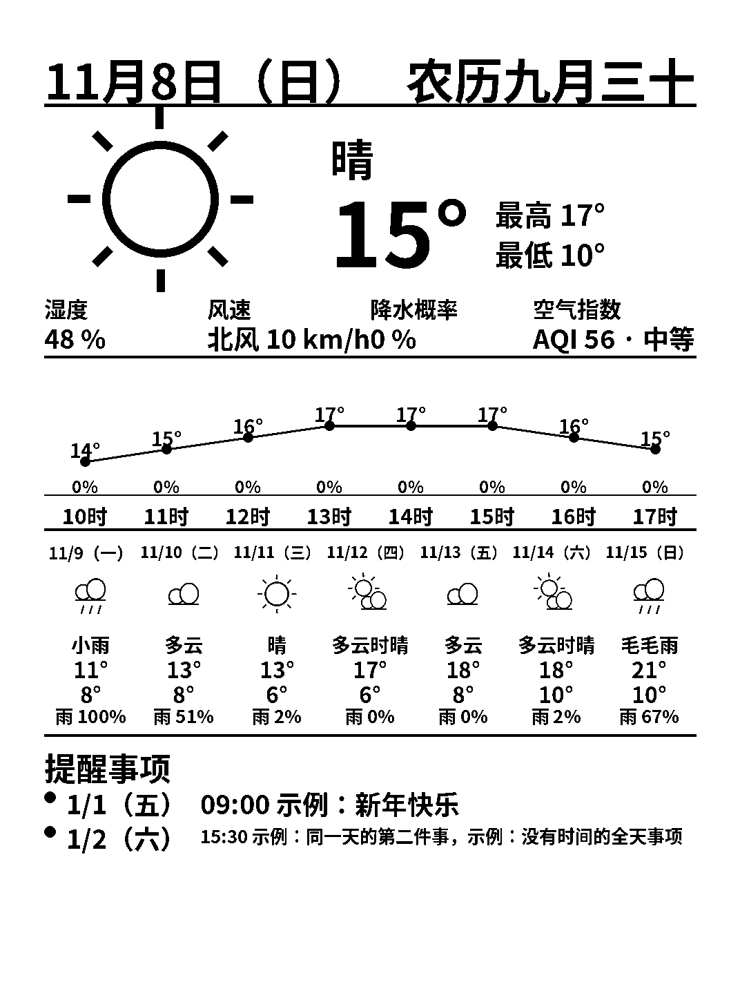

# kindle-dashboard

把一台闲置的 Kindle Paperwhite 3 变成常开的桌面信息屏：服务器每 30 分钟渲染一张
**纯黑白**图片（日期＋农历、当前天气、未来 8 小时温度/降水概率、未来 7 天预报、
提醒事项），Kindle 端定时抓取并全屏显示。电子墨水屏几乎不耗电，刷新时才闪一下。



> 界面文字为中文（天气状况、星期、农历均按中文渲染）。布局按 Paperwhite 3
> （第 7 代，1072×1448 / 300dpi）调校。

## 工作原理

```
┌──────────── 服务器 (Docker) ────────────┐      ┌──── Kindle (已越狱) ────┐
│ generate.py  每 30 分钟抓天气生成 PNG     │      │ dashboard.sh 循环:      │
│ serve.py     提供 /dashboard.png          │◄─────│  每 30 分钟下载 PNG     │
│              接收 /batt 电量上报           │ HTTP │  用 eips 全屏绘图       │
│              提供 /status 给 HA 等外部系统 │─────►│  上报电量 (可选闭环充电) │
└───────────────────────────────────────────┘      └─────────────────────────┘
```

- 天气主数据源 [Open-Meteo](https://open-meteo.com/)（免 key），失败时回退
  wttr.in + 日本气象厅（JMA 回退为日本专用）；空气质量用 Open-Meteo Air Quality。
- 农历由 `lunardate` 计算。
- 最终图片会做二值化处理：像素只有 0 和 255，**没有任何灰色**，在墨水屏上最锐利。
- Kindle 端只往用户区（`/mnt/us`）写文件，不动系统分区；重启即退出，还原成普通 Kindle。

## 前置条件

1. 一台**已越狱**的 Kindle Paperwhite 3（固件 5.16.2.1.1 可用）。越狱方法见
   Kindle Modding Wiki 的 WinterBreak（本仓库不包含越狱工具，请从官方渠道获取）。
   越狱后需要能运行 scriptlet（书档形式的 `.sh` 启动器）。
2. 一台能跑 Docker 的机器（家里的服务器、NAS、树莓派等）与 Kindle 在同一局域网。
3. 服务器能访问互联网（抓天气）。

## 部署手顺

### 第一步：部署服务器（Docker）

```bash
git clone https://github.com/<your-name>/kindle-dashboard.git
cd kindle-dashboard

cp .env.example .env
# 编辑 .env，至少改三项：
#   LAT / LON  —— 你所在地的经纬度（示例是东京站附近）
#   TZ         —— 时区，如 Asia/Tokyo、Asia/Shanghai
#   HOST_PORT  —— 对外端口，默认 8080

cp data/reminders.example.json data/reminders.json
# 按下面的格式编辑 data/reminders.json，写你自己的提醒

docker compose up -d --build
```

验证：浏览器打开 `http://<服务器IP>:8080/dashboard.png`，能看到信息屏图片即成功。
（`data/dashboard.png` 每次生成后都会更新；改完 reminders.json 等下一次生成周期生效，
或 `docker compose restart` 立即重新生成。）

不用 Docker 也可以：`pip install -r app/requirements.txt` 后，用环境变量直接运行
`app/generate.py`（生成一次）和 `app/serve.py`（HTTP 服务），自行用 systemd/cron 调度。

### 第二步：配置提醒事项

`data/reminders.json` 是一个 JSON 数组，每条：

```json
{"date": "2027-01-01", "time": "09:00", "text": "新年快乐"}
```

- `date`：`YYYY-MM-DD`；过去的日期自动不显示
- `time`：`HH:MM`，全天事项填 `""`
- `text`：显示文字；同一天的多条会按时间排序、用「，」连成一行（过长自动折成两行）
- 屏幕最多显示未来 5 天（5 个日期组）

### 第三步：部署 Kindle 端

1. USB 连接 Kindle，把仓库里的文件拷到对应位置：
   - `kindle/documents/` 里的 3 个 `.sh` → Kindle 的 `documents/` 文件夹
   - `kindle/dashboard/` 里的全部文件 → Kindle 的 `dashboard/` 文件夹
2. 在 `dashboard/` 里把 `dashboard.conf.example` 改名为 `dashboard.conf`，
   编辑里面的服务器地址（你服务器的局域网 IP 和端口）：

   ```
   DASH_URL=http://192.168.1.10:8080/dashboard.png
   DASH_BATT_URL=http://192.168.1.10:8080/batt
   ```
3. 拔线，在 Kindle 书库里点 **「Dashboard Start」**这本书（scriptlet），
   等约 30 秒，信息屏出现。再点一次 Start 可以在画面被系统界面覆盖后重绘；
   **「Dashboard Stop」**停止并恢复屏保；**「Dashboard Status」**查看状态和日志。

### 日常使用须知

- 信息屏是一张 `eips` 画上去的**图片**，不是一层 UI：点按屏幕、翻页等操作会让
  Kindle 框架把自己的界面画回来，盖住图片。等下一个刷新周期（30 分钟）会自动恢复，
  或点一次 Dashboard Start 立即重绘。想正常看书前先点 Dashboard Stop。
- 前光（frontlight）亮度不受脚本控制：亮度大于 0 时晚上会微微发光，
  放在卧室建议把亮度调到 0 或最低。
- 每 30 分钟刷新时屏幕会闪烁反转一次，这是电子墨水全刷的正常现象。
- 电量：墨水屏静态显示几乎不耗电，主要开销是 Wi-Fi 抓取和刷新。

## 配置项（服务器 .env）

| 变量 | 说明 | 默认 |
|---|---|---|
| `LAT` / `LON` | 天气位置经纬度 | 东京站附近 |
| `TZ` | 时区（IANA 名） | `Asia/Tokyo` |
| `HOST_PORT` | 宿主机映射端口 | `8080` |
| `GENERATE_INTERVAL` | 重新生成间隔（秒） | `1800` |
| `WTTR_LOCATION` | 回退数据源 wttr.in 的地名 | `Tokyo` |
| `JMA_AREA_CODE` | 回退数据源气象厅地区码（日本专用） | `130000`（东京） |
| `SCREEN_W` / `SCREEN_H` | 目标屏幕尺寸（布局按 1072×1448 调校，改尺寸不保证版式） | `1072` / `1448` |

## 可选：智能充电闭环（Home Assistant）

Kindle 每个周期会向 `/batt?level=<电量>` 上报电量，服务器存到 `battery.json`，
并通过 `GET /status` 提供。配合一个智能插座和 Home Assistant，可以让电量
长期保持在 50%～90%，延长电池寿命：

1. HA 的 `configuration.yaml` 加 REST 传感器：

```yaml
sensor:
  - platform: rest
    name: kindle_battery
    resource: http://<服务器IP>:8080/status
    value_template: "{{ value_json.level }}"
    unit_of_measurement: "%"
    scan_interval: 300
```

2. 两个自动化（示意）：电量 `< 50` 时打开插座、 `> 89` 时关闭插座；
   建议同时加「每 30 分钟」的时间触发 + 同条件的数值状态**条件**做自检，
   避免传感器边缘状态下漏触发。

## 目录结构

```
app/            服务器端 Python（generate.py 生成器、serve.py HTTP 服务）
kindle/         Kindle 端（dashboard.sh 循环脚本 + documents/ 启动器 scriptlet）
data/           reminders.json（你的提醒）与生成物所在目录（挂载进容器）
docs/           示例图
Dockerfile / docker-compose.yml
```

## 免责声明

- 本项目与 Amazon、Kindle 商标无关；越狱会失去保修并有变砖风险，请自行评估。
- 天气数据来自 Open-Meteo 等公开接口，其可用性与准确性由数据源决定。

## License

MIT
